# Heart Disease Prediction: End-to-End MLOps Pipeline

**Course:** Machine Learning Operations (AIMLCZG523), Assignment 1  
**Student:** _&lt;your name&gt;_ (2025AE05141)  
**Repository:** <https://github.com/khuranaj95/heart-disease-mlops>  
**Environment:** BITS Prayogshala Linux server, Python 3.12.9, Docker 28, Minikube (Kubernetes v1.32)

---

## 1. Summary

This project builds a classifier that predicts the presence of heart disease from 13
clinical measurements (UCI Heart Disease, Cleveland subset, 303 patients), and takes it
all the way to a monitored API running on Kubernetes:

| Stage | What was built |
|---|---|
| Data & EDA | Download script, cleaning script, EDA notebook with 4 figures |
| Modelling | scikit-learn pipeline, Logistic Regression vs Random Forest, GridSearchCV with stratified 5-fold CV |
| Tracking | MLflow: 2 parent runs and 16 nested child runs (one per grid setting), metrics, plots, models |
| Packaging | Full pipeline saved as `model.joblib` and as an MLflow model; pinned `requirements.txt` |
| CI/CD | GitHub Actions: lint → tests → train, plus Docker build and smoke test |
| Serving | FastAPI `/predict` in a Docker image (python:3.12-slim, non-root) |
| Deployment | Minikube: Deployment (2 replicas, probes) + LoadBalancer Service |
| Monitoring | `/metrics` (prometheus_client), JSON request logs, Prometheus + Grafana dashboard |

**Final model:** Logistic Regression (C = 1.0) with **cross-validated ROC-AUC 0.902** and,
on the held-out test set, ROC-AUC 0.966, recall 0.929 and accuracy 0.885.

## 2. Architecture

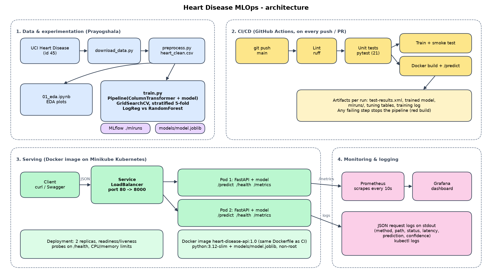

The system has four parts. **(1)** Data is downloaded, cleaned and used to train and
compare models, with every run logged to MLflow. **(2)** On every push, GitHub Actions
lints the code, runs the unit tests, retrains the model and builds/tests the Docker image;
any failure stops the pipeline. **(3)** The Docker image (code + trained pipeline) runs as
two pods behind a LoadBalancer service on Minikube. **(4)** Prometheus scrapes each pod's
`/metrics` endpoint, Grafana visualises it, and every request is logged as a JSON line.

## 3. Setup and installation

```bash
git clone https://github.com/khuranaj95/heart-disease-mlops.git
cd heart-disease-mlops
python3.12 -m venv .venv && source .venv/bin/activate
pip install -r requirements.txt

python scripts/download_data.py                 # data/raw/heart_raw.csv
python src/preprocess.py                        # data/processed/heart_clean.csv
jupyter nbconvert --to notebook --execute --inplace notebooks/01_eda.ipynb
python -m src.train                             # MLflow runs + models/model.joblib
python -m pytest -v                             # 21 unit tests
python -m src.predict data/sample_request.json  # inference from the command line
```

Docker and Kubernetes:

```bash
docker build -t heart-disease-api:1.0 .
docker run -p 8000:8000 heart-disease-api:1.0          # http://localhost:8000/docs

minikube start --driver=docker
minikube image load heart-disease-api:1.0
kubectl apply -f k8s/                                  # API deployment + service
kubectl apply -f k8s/monitoring/                       # Prometheus + Grafana
minikube tunnel                                        # gives the LoadBalancer an external IP
minikube service heart-disease-api --url               # alternative access URL
```

Reproducibility was verified by creating a brand-new virtual environment from
`requirements.txt` only and re-running every step: all scripts ran and produced identical metrics.

## 4. Data acquisition and EDA

**Source.** `scripts/download_data.py` fetches dataset id 45 from the UCI repository with
`ucimlrepo` and saves it unchanged to `data/raw/heart_raw.csv` (303 rows, 13 features + `num`).

**Cleaning** (`src/preprocess.py`):

- **Missing values:** only 6 of 303 values are missing (4 in `ca`, 2 in `thal`). Both are
  categorical, so they are filled with the **mode** rather than the mean (a mean like
  "0.67 vessels" is not a valid category) and no patients are dropped from an already small dataset.
  The script also converts the `?` markers used in the original UCI file.
- **Target:** the original `num` (0 = healthy, 1-4 = increasing severity) is converted to
  binary: 0 → 0, 1-4 → 1.

**Class balance.** 164 patients without disease vs 139 with disease (54% / 46%): nearly
balanced, so accuracy is meaningful, but precision, recall and ROC-AUC are reported too.

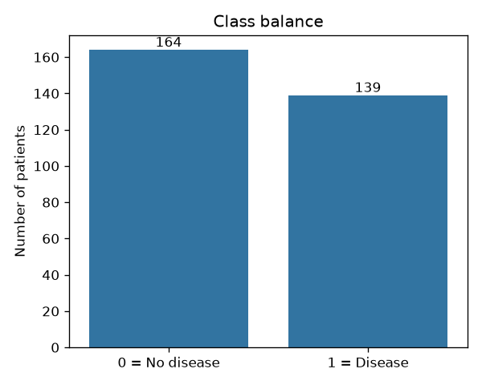
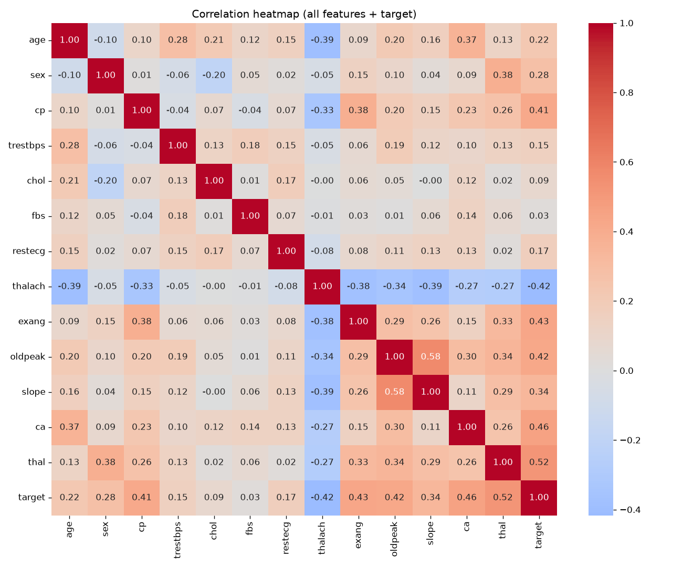

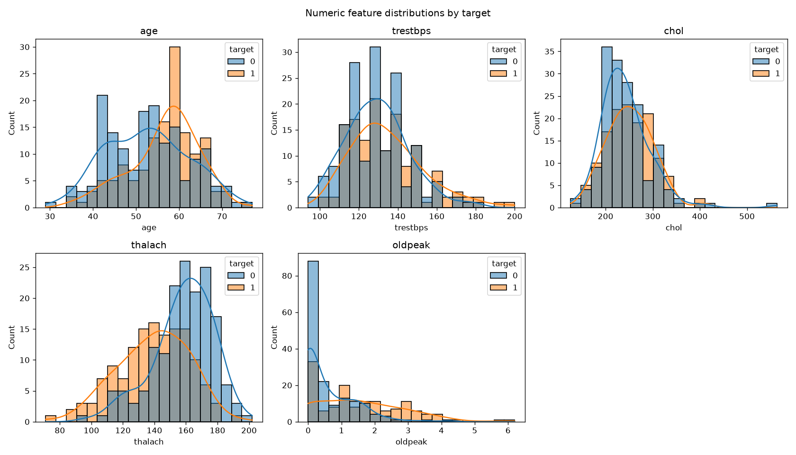

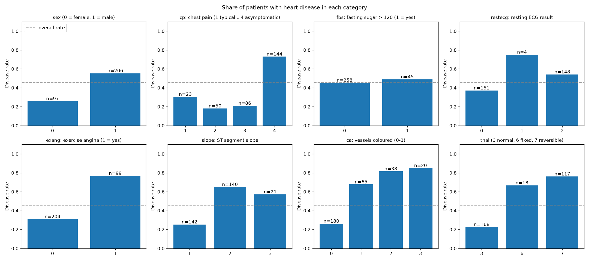

**Key findings.**

- Strongest correlations with the target: `thal` (0.52), `ca` (0.46), `exang` (0.43),
  `oldpeak` (0.42), `thalach` (-0.42) and `cp` (0.41). `chol` (0.09) and `fbs` (0.03) are weak on their own.
- Patients with **asymptomatic** chest pain (`cp` = 4) have a 73% disease rate versus 18-30%
  for the "typical" pain types, a counter-intuitive but well-known property of this dataset.
- The disease rate climbs steadily with the number of coloured vessels (`ca`): 26% at 0 up to 85% at 3.
- `restecg` = 1 has only 4 patients: a rare category, which is why the encoder ignores unseen values.
- Features are on very different scales (`chol` ≈ 250, `oldpeak` ≈ 1), so scaling is needed.

## 5. Feature engineering and model development

**Preprocessing** (`src/features.py`) is a `ColumnTransformer` inside a scikit-learn `Pipeline`:

| Feature group | Columns | Steps | Reason |
|---|---|---|---|
| Numeric | age, trestbps, chol, thalach, oldpeak | median imputer → StandardScaler | median is robust to outliers (chol = 564); scaling matters for Logistic Regression |
| Categorical | sex, cp, fbs, restecg, exang, slope, ca, thal | most-frequent imputer → OneHotEncoder(handle_unknown="ignore") | codes are labels, not quantities; unseen codes do not crash the API |

Because preprocessing lives inside the pipeline, it is fitted only on the training folds
during cross-validation (no data leakage), and the saved model applies exactly the same
transformations at prediction time.

**Training procedure** (`src/train.py`): stratified 80/20 train/test split (242 / 61
patients, random_state = 42). Each model is tuned with `GridSearchCV` using **stratified
5-fold CV** scored on ROC-AUC, while accuracy, precision and recall are recorded for every fold.

| Model | Grid | Settings |
|---|---|---|
| Logistic Regression | C ∈ {0.01, 0.1, 1, 10} | 4 |
| Random Forest | n_estimators ∈ {100, 300}, max_depth ∈ {None, 5, 10}, min_samples_leaf ∈ {1, 5} | 12 |

**Results**

| Model | Split | Accuracy | Precision | Recall | ROC-AUC |
|---|---|---|---|---|---|
| **Logistic Regression** (C=1.0) | CV | 0.847 | 0.877 | 0.783 | **0.902** |
| | Test | 0.885 | 0.839 | **0.929** | **0.966** |
| Random Forest (300 trees, leaf=5) | CV | 0.810 | 0.810 | 0.774 | 0.902 |
| | Test | 0.852 | 0.806 | 0.893 | 0.948 |

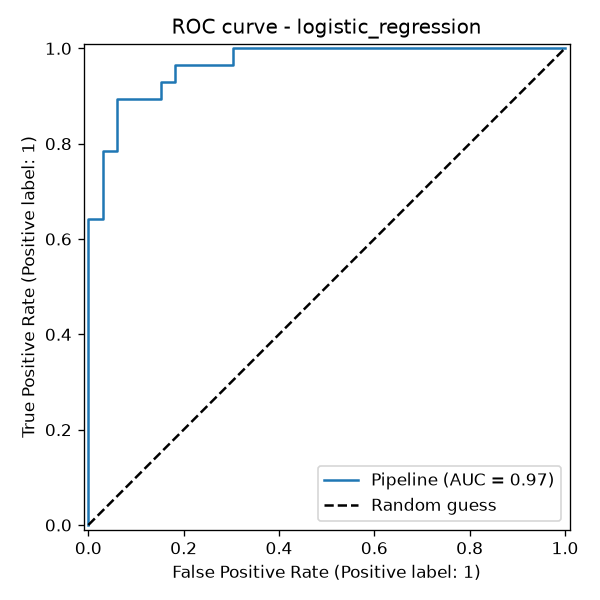
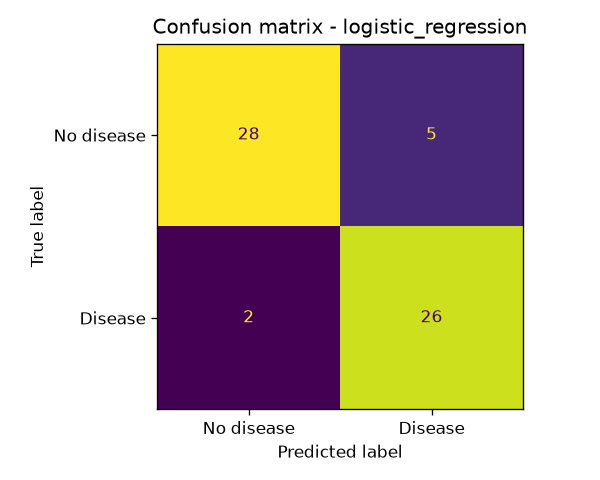

**Model selection: Logistic Regression.** The model is chosen on **cross-validated**
ROC-AUC, never on the test set, which stays untouched until the end. The two models are
effectively tied (0.9025 vs 0.9023), so the decision used the secondary criteria:

1. **Recall:** a missed sick patient is worse than a false alarm; LR has higher recall in CV
   (0.783 vs 0.774) and finds 26 of the 28 sick test patients.
2. **Stability:** LR's fold-to-fold ROC-AUC spread is ±0.014 versus ±0.033 for the forest.
3. **Simplicity:** one interpretable weight per feature, which suits a 303-patient dataset.

Tuning observations: very strong regularisation (C = 0.01) costs a lot of recall (0.69), and
C between 0.1 and 10 forms a flat plateau. For the forest, every top setting uses
`min_samples_leaf = 5`, which limits overfitting on the small dataset. Test scores are higher than
CV scores because 61 patients is a small, noisy test set; ~0.90 ROC-AUC is the realistic
expectation. Full tables: `report/model_selection.md` and `report/tuning/`.

## 6. Experiment tracking (MLflow)

All training is logged to the MLflow experiment **`heart-disease`** (local `./mlruns` store):

- **One parent run per model** with the best parameters, 4 CV metrics and 4 test metrics,
  the ROC curve and confusion matrix PNGs, the full grid table (CSV), and the fitted pipeline
  logged as an MLflow model with an input signature and example.
- **One nested child run per grid setting** (16 in total) with its parameters, CV metrics and
  rank, so the entire tuning process is visible, not only the winner.

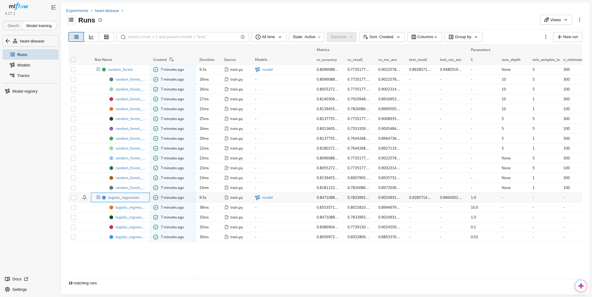

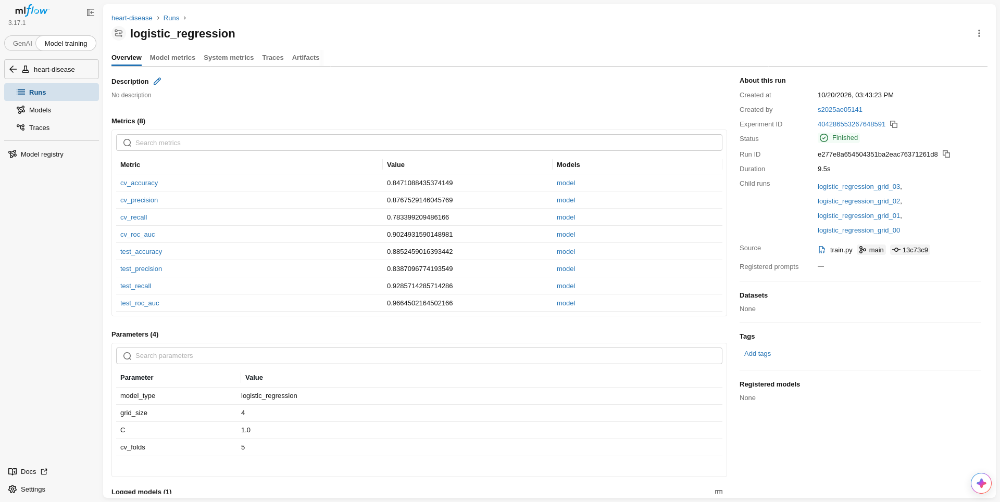

Further screenshots in `screenshots/mlflow/`: side-by-side comparison, ROC and confusion
matrix artifacts, and the tuning CSV artifact.

## 7. Model packaging and reproducibility

- **Saved model:** `models/model.joblib` holds the *whole* pipeline (imputers, scaler,
  encoder and classifier), so raw patient data goes in and a prediction comes out. The same
  pipeline is logged as an MLflow model, and `models/metadata.json` records the feature list,
  metrics, MLflow run ID and exact library versions.
- **Inference:** `src/predict.py` loads the model once and returns
  `prediction`, `label`, `confidence` and `probability_disease`; it is reused by the API.
- **Environment:** `requirements.txt` pins every library to an exact version;
  `requirements-serve.txt` pins the 7 libraries the API image needs (same versions).
- **Determinism:** fixed `random_state = 42` for the split, CV folds and Random Forest.

## 8. CI/CD pipeline and automated testing

**Unit tests** (`tests/`, 21 tests, pytest):

| File | What it checks |
|---|---|
| `test_preprocess.py` | `?`/NaN handling, mode filling, binary target, integer types, input not modified |
| `test_features.py` | feature lists, output shape, scaling (mean 0 / std 1), missing and unseen values |
| `test_predict.py` | output format, label/probability consistency, known patients, missing feature |
| `test_train.py` | model configuration, metric ranges, **quality gate: CV ROC-AUC ≥ 0.85** |
| `test_api.py` | `/health`, `/predict` response, 422 on invalid or missing input, `/metrics` counters |

**GitHub Actions** (`.github/workflows/ci.yml`) runs on every push and pull request to `main`:

1. **Lint:** `ruff check` and `ruff format --check`.
2. **Unit tests:** `pytest -v`, JUnit report uploaded as an artifact.
3. **Train model:** clean data, train, smoke-test the model; uploads the model, `mlruns/`,
   tuning tables and training log as artifacts.
4. **Docker:** build the image, start it, wait for `/health`, call `/predict` and check the answer.

Jobs depend on each other (`needs:`), every step runs under `bash -eo pipefail`, and the
quality gate turns a model regression into a failing test, so **any code, test or model
error produces a red build with the failing step's log**.

**Evidence.** The first runs on GitHub: two green runs on `main`, and one run on a
throw-away branch `ci-failure-demo` that contained a deliberate bug (the target was set to 1
for every patient).

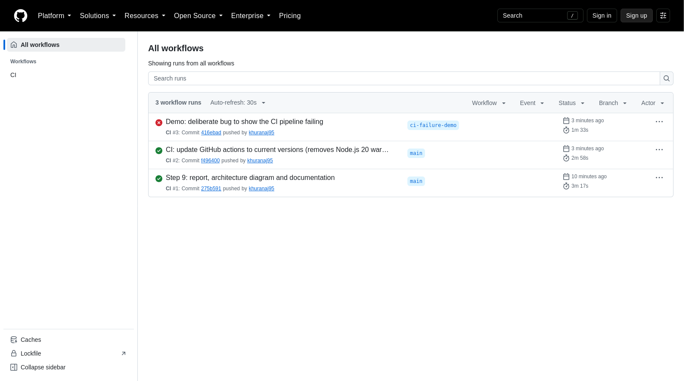

A green run: all four jobs pass and upload the `test-results` and `trained-model` artifacts.

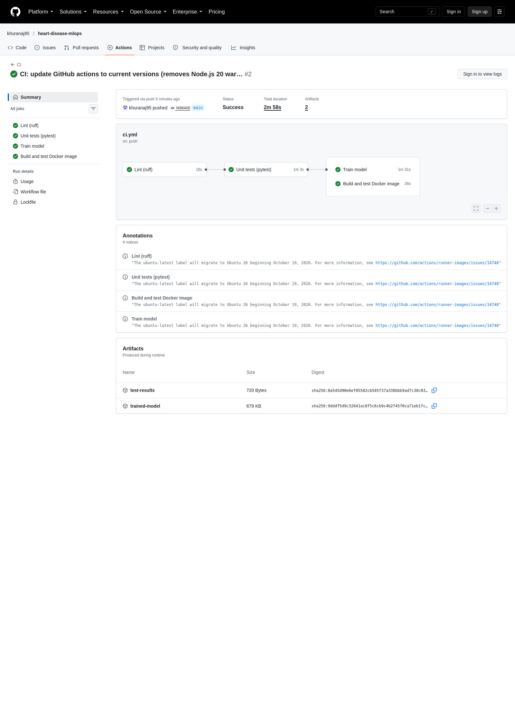

The failure demo: `test_target_is_binary` caught the bug, the **Unit tests** job failed with
exit code 1, and **Train model** and **Docker build were skipped**, so a broken commit can
never produce a model or an image.

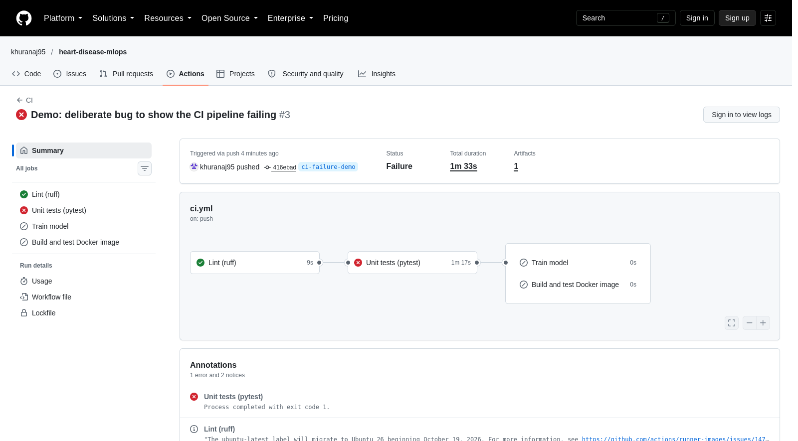

## 9. Model containerisation

`src/api.py` is a FastAPI service:

- `POST /predict` takes the 13 features as JSON. Pydantic validates types and ranges
  (e.g. `age` 1-120, `thal` ∈ {3, 6, 7}) and returns HTTP 422 with a clear message for bad input.
- It returns `{"prediction": 1, "label": "disease", "confidence": 0.9856, "probability_disease": 0.9856}`.
- `GET /health` is used by Docker and Kubernetes probes, and `GET /metrics` by Prometheus.

The `Dockerfile` uses `python:3.12-slim`, installs dependencies in a cached layer, copies only
`src/` and `models/`, runs as a non-root user and defines a `HEALTHCHECK`. The image is 465 MB.

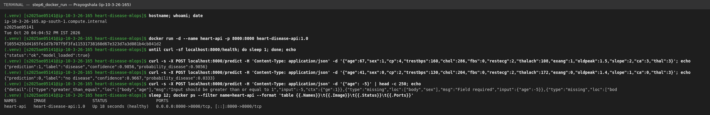

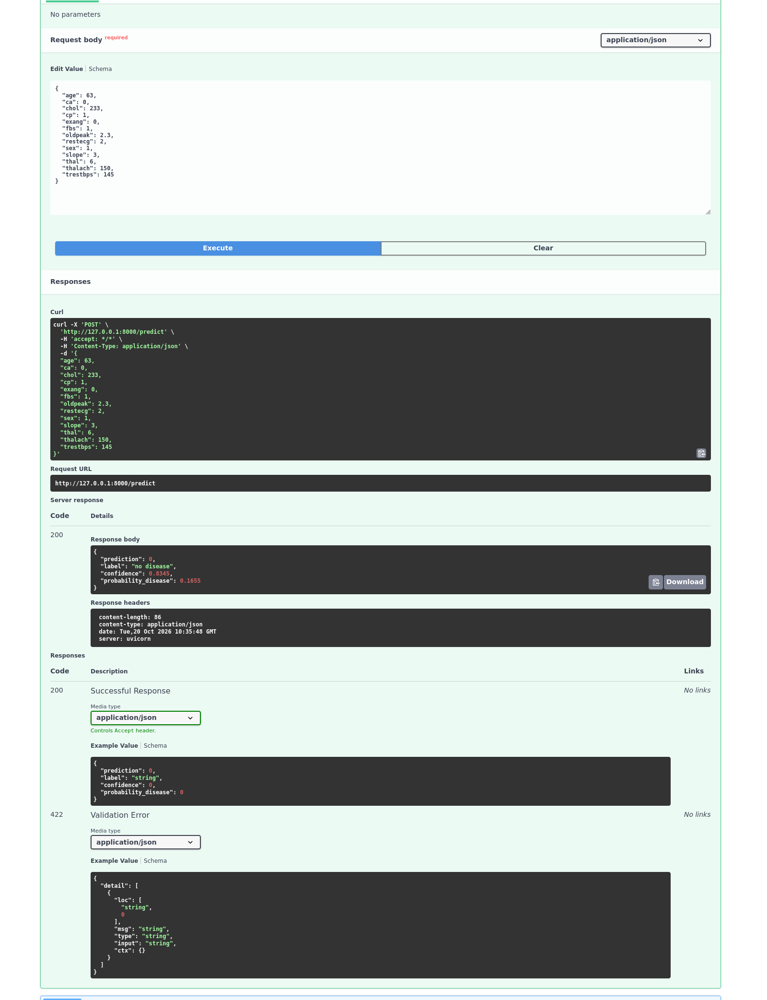

## 10. Production deployment (Minikube)

`k8s/deployment.yaml` runs **2 replicas** with CPU/memory requests and limits, a
**readiness probe** (no traffic until the model is loaded) and a **liveness probe** (restart if
`/health` stops answering). `k8s/service.yaml` exposes them through a **LoadBalancer** service
on port 80; `minikube tunnel` assigns its external IP (`10.105.141.103`).

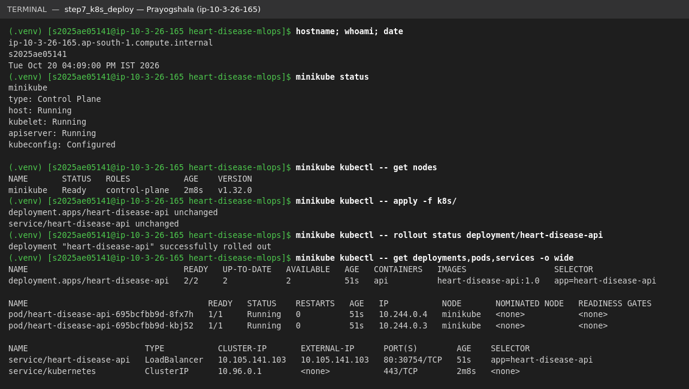

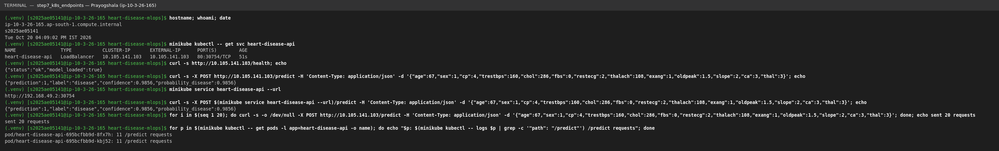

Endpoint verification: `/health` and `/predict` answer through both the LoadBalancer IP and the
`minikube service` URL, and 20 consecutive requests were split evenly across the two pods
(11 / 11 including earlier calls).

**Access instructions (local testing):** after `kubectl apply -f k8s/`, run
`minikube service heart-disease-api --url`, then `POST <url>/predict` with JSON as in
`data/sample_request.json`; interactive docs are at `<url>/docs`.

## 11. Monitoring and logging

- **Request logging:** middleware writes one JSON line per request (method, path, status,
  latency, client) plus one per prediction (label, confidence). The patient's health data is
  deliberately not logged. Logs go to stdout, so `docker logs` / `kubectl logs` collect them.
- **Metrics** (`prometheus_client`): `api_requests_total{method,endpoint,status}`,
  `api_request_duration_seconds` (histogram), `model_predictions_total{label}` and
  `model_prediction_confidence` (histogram).
- **Prometheus** discovers the API pods through their `prometheus.io/scrape` annotations
  and scrapes them every 10 s; **Grafana** comes provisioned with the data source and an
  8-panel dashboard.

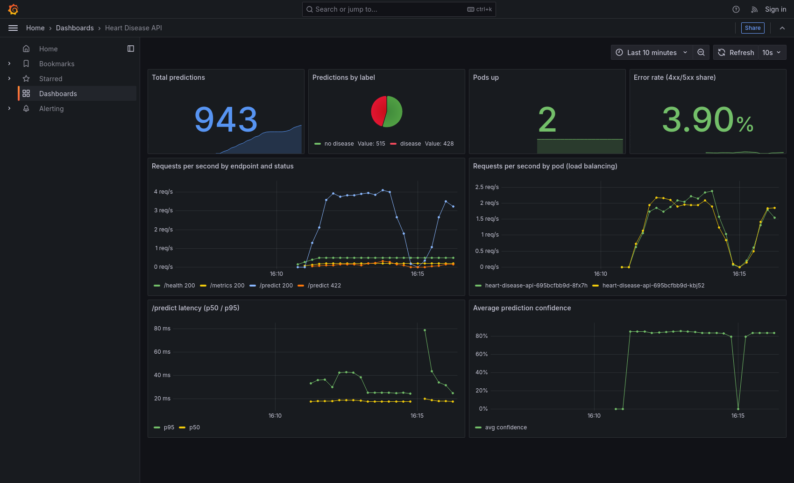

The dashboard was captured after sending ~950 requests (about 5% deliberately invalid): it
shows the prediction split, both pods up, the 3.9% error rate from the invalid requests,
traffic spread evenly across the two pods, p50/p95 latency of ~18/25-40 ms, and an
average confidence of ~85%.

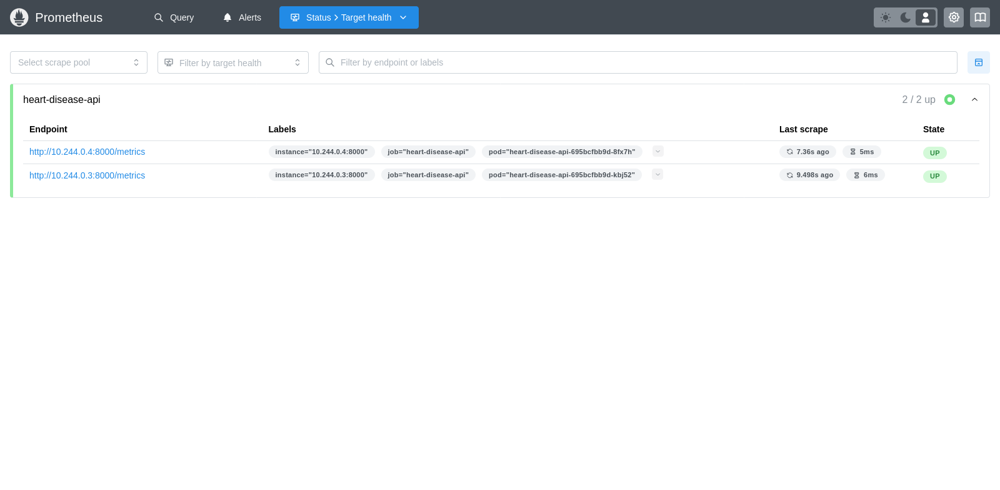

## 12. Conclusion and possible improvements

The pipeline goes from a raw UCI download to a tested, versioned, containerised and monitored
model service, and every stage runs from a clean environment. Possible next steps:

- Use a remote MLflow tracking server and model registry instead of the local folder store.
- Push the image to a registry from CI and deploy automatically (continuous delivery).
- Add Prometheus alert rules (e.g. error rate > 5%, p95 latency > 200 ms) and data-drift
  monitoring of the input feature distributions.
- Collect more data: 303 patients limit how far tuning and model choice can be trusted.

**Repository:** <https://github.com/khuranaj95/heart-disease-mlops>
